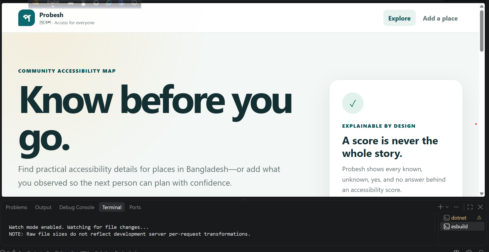
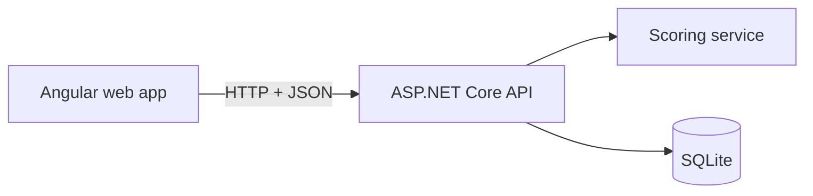

# Probesh (প্রবেশ)

**A community accessibility map for Bangladesh.**

Probesh helps people check whether a clinic, school, office, restaurant, or public place is accessible before leaving home. Community members can add a place, complete an accessibility checklist, and see a transparent score.

> Status: working learning MVP. Angular UI → ASP.NET Core API → SQLite database. All included place records are demo data or community submissions; they are not independently verified claims about real venues.



[Explore screenshot](screenshots/explore.png)

**Live demo:** not deployed yet. Run locally using the steps below.

## Why this belongs in a portfolio

- Solves a real social problem instead of copying an e-commerce tutorial.
- Demonstrates Angular, TypeScript, reactive forms, HTTP, routing, and accessible UI.
- Demonstrates ASP.NET Core, REST, validation, dependency injection, EF Core, LINQ, and SQL.
- Has a clear future AI/computer-vision extension for assisting photo review.
- Creates a strong interview story about product decisions, data quality, privacy, and inclusive design.

## Current MVP

- Browse and search accessible places.
- Filter by place category and accessibility level.
- View checklist-based accessibility details and a transparent score.
- Submit a new place for community review.
- Show dashboard totals from the API.
- Seed safe, clearly labelled demo records.
- Expose an OpenAPI document for the backend.
- Unit-test the accessibility scoring rule.

Authentication, a reviewer moderation UI, real photo uploads, maps, and deployment are later milestones. Submission status is recorded, but a public verification badge on seeded demo records does not mean an actual venue was audited.

## Stack

| Layer | Technology | What you learn |
| --- | --- | --- |
| Frontend | Angular 22, TypeScript, SCSS | Components, signals, routing, reactive forms, HTTP |
| Backend | ASP.NET Core 10 Web API | Controllers, DTOs, DI, validation, async/await |
| Data | EF Core 10 + SQLite for MVP | Entities, relationships, LINQ, persistence |
| Tests | xUnit | Business-rule testing |
| Later production | PostgreSQL, object storage, CI/CD | Deployment and production operations |

.NET 10 is an LTS release, and Angular 22 is the active Angular line selected for this learning build.

## Architecture



The code is a **modular monolith**. That is the right size for a solo junior portfolio project: simple to understand and deploy, but structured enough to grow.

## Run locally

### Requirements

- .NET 10 SDK
- Node.js 22 LTS or a newer Angular-supported release
- Git

### 1. Start the API

```bash
cd backend
dotnet restore
dotnet run
```

The API starts at `http://localhost:5074`. Its OpenAPI document is at `http://localhost:5074/openapi/v1.json`.

### 2. Start Angular

Open another terminal:

```bash
cd frontend
npm install
npm start
```

Open `http://localhost:4200`.

### 3. Run backend tests

From the repository root:

```bash
dotnet test tests/Probesh.Api.Tests/Probesh.Api.Tests.csproj
```

The SQLite database file is created automatically inside `backend` on first run. See [database/README.md](database/README.md) for the current schema. The `.gitignore` excludes local database files and build output.

## Repository layout

- `frontend/` — Angular application
- `backend/` — ASP.NET Core API and EF Core models
- `database/` — schema and migration status
- `screenshots/` — screenshots from a local demo
- `tests/` — backend scoring tests

## Your learning route

Start with [docs/LEARNING_JOURNEY.md](docs/LEARNING_JOURNEY.md). Do not jump directly to authentication or AI. At every checkpoint you will explain one concept, make one change, and show proof that it works.

More project decisions are documented in:

- [Product brief](docs/PRODUCT_BRIEF.md)
- [Database and API design](docs/TECHNICAL_DESIGN.md)
- [GitHub showcase checklist](docs/GITHUB_SHOWCASE.md)
- [Validation report](docs/VALIDATION.md)

## Responsible product rules

- Accessibility data is community-contributed and may be incomplete.
- A score must always show the checklist evidence behind it.
- AI may suggest labels later, but it must never make the final accessibility decision.
- Do not expose a contributor's precise personal location or private information.
- Demo records are not claims about real places.

## License

MIT — see [LICENSE](LICENSE).
