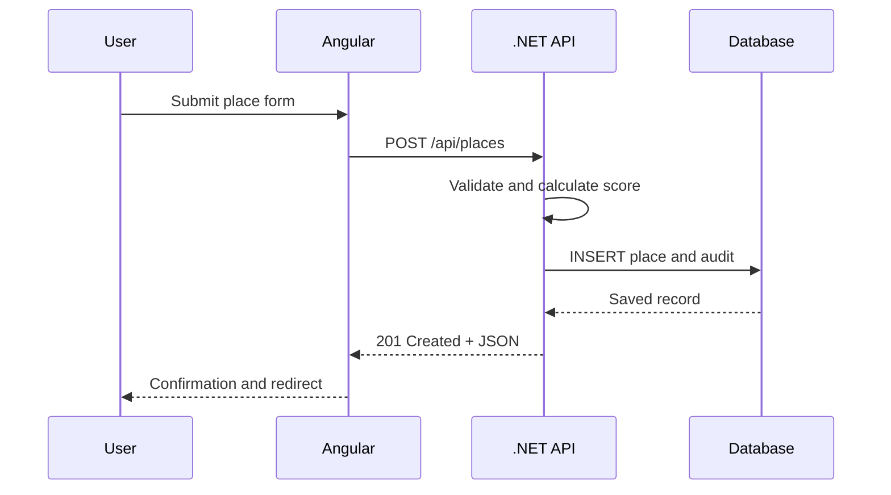
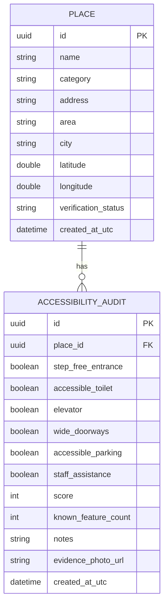

# Technical design

## Request flow



## Data model



Checklist fields are nullable in the database. `null` means “unknown,” which is different from “no.” This prevents missing data from silently becoming a negative accessibility claim.

## Scoring rule

Only known answers are scored:

```text
score = yes answers / known answers × 100
```

| Result | Level |
| --- | --- |
| No known answers | Unknown |
| 0–49 | Limited |
| 50–79 | Partially accessible |
| 80–100 | Highly accessible |

The score is a discovery aid, not a legal certification. The interface always exposes the individual checklist answers.

## Initial API

| Method | Route | Purpose |
| --- | --- | --- |
| GET | `/api/places` | List places; optional `search` and `category` query values |
| GET | `/api/places/{id}` | Get one place |
| GET | `/api/places/summary` | Dashboard totals |
| POST | `/api/places` | Submit a place and first audit |
| PATCH | `/api/places/{id}/status` | Change review status; development-only until auth is added |
| GET | `/health` | Simple health check |

## Folder responsibilities

```text
backend/
├── Controllers/   HTTP endpoints only
├── Data/          EF Core context and demo seed
├── DTOs/          Public request/response contracts
├── Models/        Database entities and enums
└── Services/      Business rules
frontend/src/app/
├── core/          API communication
├── features/      Screen-level components
└── models/        TypeScript contracts
```

## Production evolution

1. Replace `EnsureCreated` with EF Core migrations.
2. Switch SQLite to PostgreSQL.
3. Add ASP.NET Core Identity and JWT/secure cookie authentication.
4. Restrict status changes to reviewers.
5. Store photos in object storage, not the database.
6. Add OpenStreetMap after the list workflow is stable.
7. Add rate limits, audit logs, moderation, and observability.

## AI extension boundary

A later Python service can suggest whether a photo appears to contain stairs, a ramp, or an elevator. Store the model suggestion and confidence separately from the human audit. Never overwrite community evidence automatically.
